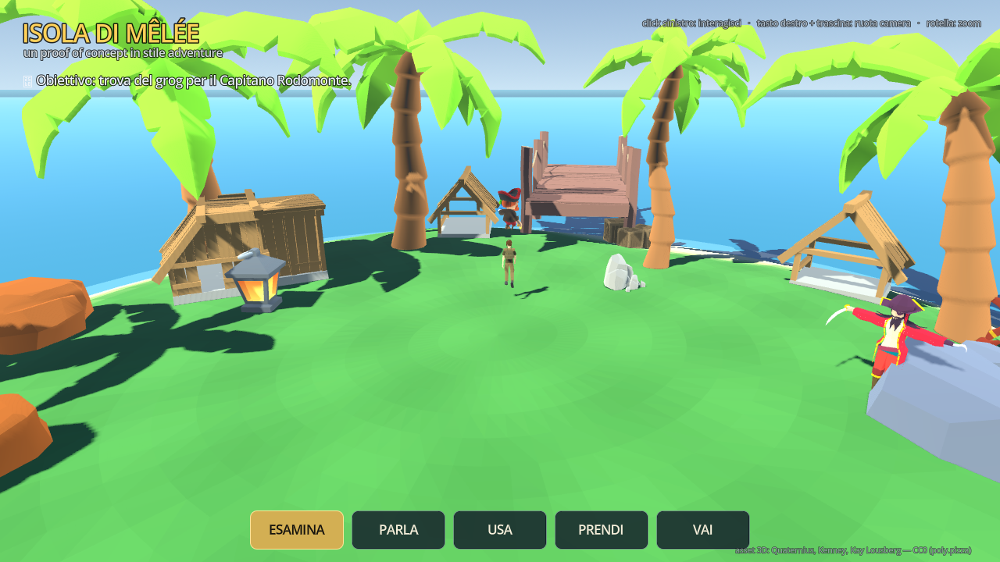

# Isola di Mêlée

POC di un **adventure 3D in stile cartoon**, con l'umorismo e i verbi di Monkey Island:
un'isola, un naufrago, un capitano che non parla con chi non ha del grog.



Gira **nel browser** (export Web) e come **applicazione nativa** (macOS / Windows).

## Cosa c'è

- Isola generata proceduralmente, con collisioni reali sul terreno.
- Personaggio giocante animato, movimento **point & click** con camera orbitale.
- Barra dei verbi (Esamina / Parla / Usa / Prendi / Vai), dialoghi e hover sugli oggetti.
- Una mini-quest completa: trova il grog → convincere il Capitano.
- Mare animato, palette toon, audio ambientale.

## Tecnologie

| Ambito | Scelta |
|---|---|
| Engine | **Godot 4.7.2** (MIT), renderer Compatibility / WebGL 2 |
| Linguaggio | GDScript |
| Fisica | Jolt (default in Godot 4.6+), `CharacterBody3D` + collisioni trimesh |
| Grafica | materiali `DIFFUSE_TOON`, shader custom per acqua e contorni |
| Asset 3D | modelli **CC0** da [Poly Pizza](https://poly.pizza) (in gran parte Quaternius) |
| Audio | loop generati con `ffmpeg`, riprodotti da `AudioStreamPlayer` |
| Build web | export template *nothreads*, server statico Node.js con gzip |
| Toolchain | Godot headless via CLI, export da macOS verso Web / macOS / Windows |

Nessun asset proprietario, nessuna dipendenza a runtime oltre al browser o al sistema.

## Avvio

**Browser** (build già pronta):

```bash
node poc/server.mjs     # → http://127.0.0.1:8090/
```

**App nativa**: `build/mac/IsolaDiMelee.app` (macOS) oppure `build/windows/IsolaDiMelee.exe`.

**Editor**: apri `poc/` con Godot 4.7.2.

## Struttura

```
poc/        progetto Godot (sorgente, script, shader, asset)
build/      export pronti: web, macOS, Windows (non versionati)
docs/       anteprima
artref/     thumbnail degli asset CC0
tools/      Godot + export template per rigenerare i build (non versionati)
```

## Stato

Prototipo: il loop di gioco funziona, l'arte è temporanea e dichiaratamente generica.
Mancano pathfinding, salvataggi, mobile e la parte AI degli NPC.
Dettagli e limiti noti in [`poc/README.md`](poc/README.md).

## Licenze

Codice del progetto: da definire. Engine: Godot (MIT). Asset 3D: CC0 1.0 —
autori e sorgenti in [`poc/assets/credits.json`](poc/assets/credits.json).
