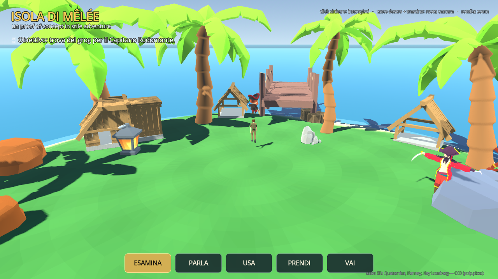

# Isola di Mêlée — POC

Proof of concept di **adventure 3D cartoon** che gira nel browser, costruito con **Godot 4.7**
(export Web, renderer Compatibility) e **soli asset 3D CC0**.



## Cosa c'è dentro

- Isola procedurale (mesh + collisioni trimesh), mare con shader animato, cielo procedurale.
- Personaggio giocante con animazioni (`Idle`/`Walk`), collisioni e movimento **click-to-move**.
- Camera orbitale che segue il giocatore (tasto destro = ruota, rotella = zoom).
- Barra dei verbi in stile Monkey Island (Esamina / Parla / Usa / Prendi / Vai).
- Dialoghi, hover sugli oggetti, obiettivo di missione.
- Mini-quest giocabile: trova il grog → parla con il Capitano.
- Audio ambientale (mare) e blip UI generati con ffmpeg.
- Look toon: materiali `DIFFUSE_TOON`, rim light, palette piatta.

## Avviarlo

```bash
node poc/server.mjs
# http://127.0.0.1:8090/
```

Il server serve `build/web` con MIME corretti, gzip sul wasm e header COOP/COEP.

## Aprirlo nell'editor

```bash
tools/Godot.app/Contents/MacOS/Godot --path poc
```

## Riesportare il build web

```bash
tools/Godot.app/Contents/MacOS/Godot --headless --path poc \
  --export-release "Web" "$PWD/build/web/index.html"
```

Il preset usa il template `web_nothreads_release.zip` (già estratto in `tools/tpl/templates`).
Build attuale: ~45 MB (wasm 38 MB, pck 7 MB); con gzip il wasm scende a ~9 MB.

## Struttura

```
poc/
  project.godot          impostazioni progetto (GL Compatibility)
  main.tscn              scena radice (tutto il resto è costruito da codice)
  export_presets.cfg     preset Web + template custom
  scripts/main.gd        mondo, props, input, quest, dialoghi
  scripts/player.gd      CharacterBody3D + animazioni
  scripts/camera_rig.gd  camera orbitale
  scripts/ui.gd          HUD, verbi, pannello dialogo
  shaders/water.gdshader mare animato
  shaders/outline.gdshader contorno (non attivo: da rifinire)
  assets/models/*.glb    asset CC0
  assets/credits.json    autore + licenza + URL di ogni modello
  server.mjs             server statico per il build
```

## Asset e licenze

Tutti i modelli sono **CC0 1.0** presi da [Poly Pizza](https://poly.pizza), in gran parte
di **Quaternius** (personaggi animati, palme, capanne, molo, rocce, cassa, lanterna, totem).

Il dettaglio per file è in `assets/credits.json`.
CC0 non richiede attribuzione, ma nei crediti in-game è comunque indicata.

## Cosa funziona / cosa no

Verificato: caricamento nel browser, rendering, terreno e collisioni, movimento del
personaggio, camera, HUD, dialoghi iniziali, export.

Da verificare a mano: interazione con gli NPC (il test automatico ha cliccato a vuoto,
il target è piccolo). Da rifinire: contorni cartoon, materiali dei personaggi,
illuminazione, pathfinding (ora il movimento è steering diretto, senza navmesh).
